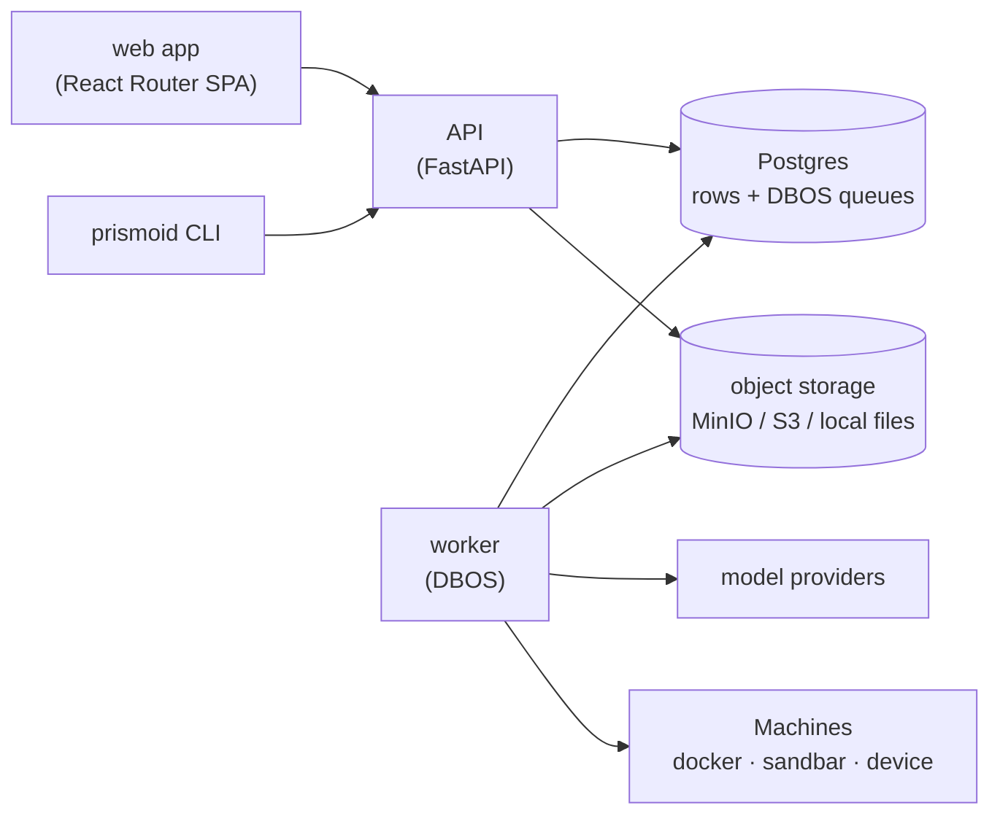

# Prismoid

Prismoid is a self-hosted digital worker. You give it an outcome ("a 10-slide deck on our Q3 numbers",
"fix the failing test in this repo", "research these five vendors and compare them in a
spreadsheet"). Prismoid plans the work into steps, runs each step with an AI agent inside a sandboxed
computer, publishes what the agents made (documents, spreadsheets, decks, code, web pages), and then
checks each artifact again and signs the result.

Makeplane runs a hosted Prismoid service, and everything here is yours to run on your own Mac or
server, as documented below. You bring a model API key; Prismoid brings the API, the durable worker,
the web app, the CLI and the sandboxes.

- **Plans, not prompts.** A task becomes a graph of steps. Independent steps run in parallel, and
  every step's progress streams live to the web app and the CLI.
- **Durable.** Tasks run as durable workflows on Postgres ([DBOS](https://www.dbos.dev/)): a worker
  that crashes mid-task resumes where it stopped.
- **Sandboxed.** Agent code runs in a per-task computer (a *Machine*) with an egress allowlist,
  never in the worker process.
- **Verified.** The answer arrives first; a verification job then re-checks every artifact and
  signs its verdict with Ed25519.
- **Any model.** Models are data in a catalog (Anthropic, OpenAI, Google, and any
  OpenAI-compatible server such as Ollama or vLLM). Adding one is a CLI command, not a deploy.

> **License:** Prismoid is free software under the [GNU Affero General Public License v3.0](LICENSE)
> (`AGPL-3.0-only`). If you run a modified Prismoid as a network service, you must offer its users the
> source of your modified version.

## How it fits together



The API accepts a task and commits it; the worker picks it up from a Postgres queue, plans it,
runs each step in a Machine, stores the artifacts and delivers the answer. See
[docs/architecture.md](docs/architecture.md) for the full picture and
[docs/engine-tour.md](docs/engine-tour.md) to follow one task through the code.

| Folder | What it is |
|---|---|
| [`backend/`](backend/README.md) | The Python service: API, DBOS worker, engine, CLI (`prismoid`), migrations |
| [`web/`](web/README.md) | The web app (React Router v7, single-page, typed from `docs/api`) |
| [`packages/blocks/`](packages/blocks/README.md) | Shared React components the web app builds on |
| [`sandbar/`](sandbar/README.md) | A standalone sandbox daemon in Go, used as a server-side Machine driver |
| [`deploy/`](deploy/DEPLOY.md) | The single-host production stack (Docker Compose + Caddy) |
| [`docs/`](docs/) | Architecture, decision records, the API contract, runbooks |

## Prerequisites

| Tool | Version | Needed for |
|---|---|---|
| [Docker](https://docs.docker.com/get-docker/) | Docker Desktop or Engine with Compose v2 | The dev stack (Postgres, [Silo](https://github.com/pgsty/silo) object storage) and the default `docker` Machine driver |
| [uv](https://docs.astral.sh/uv/) | recent | The backend; it installs Python 3.12 for you |
| [Node.js](https://nodejs.org/) + [pnpm](https://pnpm.io/) | Node 22, pnpm 12 (`corepack enable` picks the pinned version) | The web app |
| [just](https://just.systems/) | recent | Every command below |
| [Go](https://go.dev/) | 1.25 | Only for the `sandbar` driver |
| A model API key | Anthropic, OpenAI or Google | Every task. Models cost money: each call is metered in Prismoid's ledger |

## Quickstart (about 15 minutes)

There are two ways to run Prismoid on your own computer. Both need one model key.

### Option A: the dev stack (macOS or Linux, uses Docker)

```sh
git clone <this repository> prismoid && cd prismoid
just install                          # backend dependencies (uv sync --all-groups)
pnpm install --frozen-lockfile        # web dependencies
cp backend/.env.example backend/.env  # then set one key, e.g. PRISMOID_WORKER_ANTHROPIC_API_KEY=...
just up migrate                       # Postgres + Silo (S3) in Docker, schema, built-in skills
just cli models seed                  # the starter model catalog (edit backend/prismoid/runner/default_models.yaml first if you like)
just dev                              # API on :8100, worker, web app on :5173 (logs in /tmp/prismoid-*.log)
```

Open <http://localhost:5173/signup> and create an account (`backend/.env.example` turns signup
on for local use), or do it from the terminal:

```sh
just cli login --signup --email you@example.com
just cli do "Write a 300-word memo on why verification matters" --wait
```

The first task builds the sandbox image, so it takes a few minutes longer than later ones.
`just status` shows what is running and `just stop` stops it. To open the operator console, make
yourself a platform admin with `just cli admin bootstrap --email you@example.com` and run
`pnpm --filter web dev:admin` (it serves on :5174).

### Option B: `prismoid up`, everything on one Mac (macOS only, no Docker; Linux is coming soon)

Local mode runs Prismoid as one supervised process tree on your Mac: an embedded Postgres (Unix socket
only), files on disk instead of MinIO, and your Mac itself as the Machine (the `device` driver),
with every agent command inside a macOS sandbox profile.

```sh
just install && pnpm install --frozen-lockfile
just web-local                                    # build the web app the API will serve
export PRISMOID_WORKER_ANTHROPIC_API_KEY=...          # or put the line in ~/.prismoid/config
just cli up                                       # asks for the owner's email and password on first run
```

Then open <http://127.0.0.1:8100>. `just cli status` reports the running instance and
`just cli down` stops it (`just cli up --background` runs it detached). Data lives in
`~/Library/Application Support/Prismoid` (set `PRISMOID_LOCAL_HOME` to move it). Browser tasks need Google
Chrome; LibreOffice and poppler (`pdftoppm`) are optional and enable document previews.

## Machine drivers

A Machine is the computer a task's agents work in. The driver is one setting,
`PRISMOID_WORKER_FRAME_DRIVER`:

| Driver | Where tasks run | Setup | Use it for |
|---|---|---|---|
| `docker` (default) | A container per Machine on the local Docker daemon, on an internal network behind an egress proxy | None | Development and trusted users. Containers share the host kernel |
| `sandbar` | The [`sandbar`](sandbar/README.md) daemon, which owns the Docker socket and gives each sandbox its own network | `just sandbar-dev`, then `PRISMOID_WORKER_FRAME_DRIVER=sandbar`, `PRISMOID_WORKER_SANDBAR_TOKEN=dev`, `PRISMOID_WORKER_SANDBAR_BACKEND=docker` | Servers; this is what [`deploy/`](deploy/DEPLOY.md) runs. The Docker backend shares the host kernel; gVisor (`SANDBAR_DOCKER_RUNTIME=runsc`) is optional and unproven, and the Firecracker backend is experimental |
| `device` | The user's own Mac, under a Seatbelt (`sandbox-exec`) profile | `prismoid up` (Option B) | One person on their own computer. macOS only |

### Self-host on AWS

To run Prismoid for a team on your own EC2 instance (Ubuntu 24.04, the `sandbar` driver on its Docker
backend, every image built on the box), follow the "On AWS (EC2)" section of
[`deploy/PROVISION.md`](deploy/PROVISION.md). Because containers share the instance's kernel, use it
for yourself and people you trust.

See [docs/security/threat-model.md](docs/security/threat-model.md) for what each driver does and
does not protect against.

## The dev loop

| Command | What it does |
|---|---|
| `just` | List every recipe |
| `just dev` / `just status` / `just stop` | Start, inspect and stop the API, worker and web dev server |
| `just api`, `just worker`, `just web-dev` | Run one process in the foreground |
| `just check` | The gate before every commit: lint, types, import layers, audit greps, the quality ratchet, unit tests, the web checks |
| `just test` | The whole backend suite, including integration tests (needs `just up`; refuses to run while `just dev` is up) |
| `just cli <args>` | The `prismoid` CLI against `PRISMOID_CLI_API_URL` (default `http://localhost:8100`) |
| `just export-contract` then `just web-gen` | Refresh the API contract in `docs/api` and the web app's generated types |
| `just revision "message"` then `just migrate` | Add and apply a database migration (Alembic) |
| `just psql`, `just logs`, `just nuke` | Poke at the database, tail the stack, wipe the stack's data |

Default local ports: API 8100, web 5173, admin console 5174, Postgres 5433 (not 5432, to avoid a
Postgres you already run), Silo's S3 API 9000 (console 9001), egress proxy control 3129, sandbar 7070.
When one is taken, export the matching variable before `just up` and point the matching `.env`
line at the new port: `PRISMOID_DB_PORT` (both database URLs), `PRISMOID_MINIO_PORT` (both S3 endpoints),
`PRISMOID_MINIO_CONSOLE_PORT`, `PRISMOID_EGRESS_CONTROL_PORT` (`PRISMOID_WORKER_EGRESS_CONTROL_URL`). Set
`COMPOSE_PROJECT_NAME` as well to run a second stack beside the first.

## Documentation

| To... | Read |
|---|---|
| Contribute: setup, tests, commit style, recipes for models, tools, agents and skills | [CONTRIBUTING.md](CONTRIBUTING.md) |
| Learn the words Prismoid uses (Task, Step, Machine, Gate, ...) | [docs/GLOSSARY.md](docs/GLOSSARY.md) |
| See the components and the task lifecycle | [docs/architecture.md](docs/architecture.md) |
| Follow one task through the code | [docs/engine-tour.md](docs/engine-tour.md) |
| Understand a design decision | [docs/adr/README.md](docs/adr/README.md) (the decision record index) |
| Drive Prismoid day to day from the CLI | `prismoid --help`, and [HANDOFF.md §5.6](HANDOFF.md) (the command surface) |
| Deploy on a server | [deploy/DEPLOY.md](deploy/DEPLOY.md) and [deploy/PROVISION.md](deploy/PROVISION.md) |
| Report a vulnerability | [SECURITY.md](SECURITY.md) |
| Understand the security model | [docs/security/threat-model.md](docs/security/threat-model.md) |
| Read the craft standard code is reviewed against | [docs/engineering.md](docs/engineering.md) |
| See what changed | [CHANGELOG.md](CHANGELOG.md) |

`CLAUDE.md` at the root and in each major folder holds the standing rules for that part of the
code. They are written for AI coding tools and humans alike; CONTRIBUTING explains how to use them.

## Community

Please read the [Code of Conduct](CODE_OF_CONDUCT.md). Bugs and feature ideas go to GitHub issues;
security reports go through [SECURITY.md](SECURITY.md), never a public issue.
