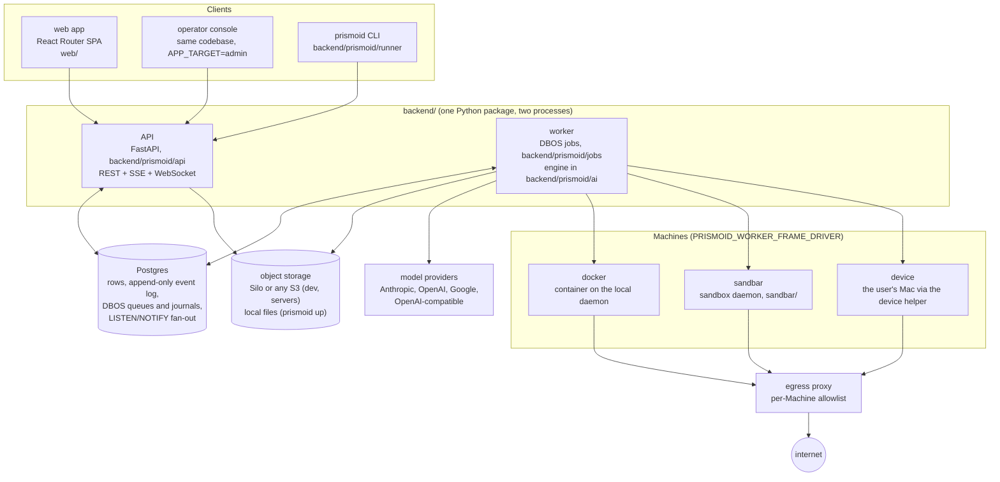
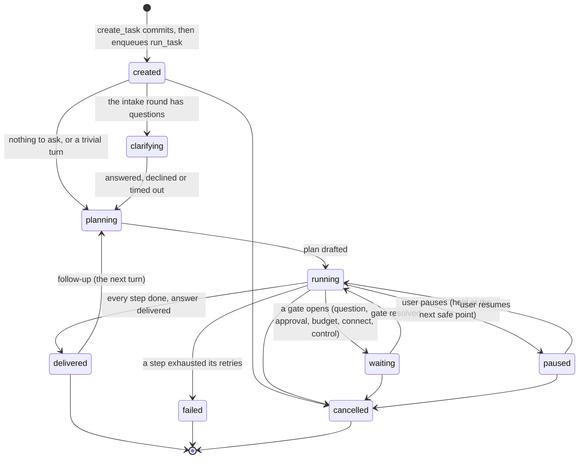

# Architecture

This page is the map: the processes Prismoid runs, what each owns, how a task moves through them, and
where the code for each part lives. To follow one task through the actual functions, read
[engine-tour.md](engine-tour.md). Terms are defined in [GLOSSARY.md](GLOSSARY.md).

## Components

| Component | Owns | Code |
|---|---|---|
| **API** | Authentication, request validation, the HTTP surface, live streams to clients. Every endpoint makes one call into `operations/` and never touches an agent | `backend/prismoid/api/` (routes listed in `api/urls.py`) |
| **Operations** | Business rules and transactions. The only layer that composes rows, agents and jobs; it enqueues jobs only after its transaction commits | `backend/prismoid/operations/` |
| **Worker** | Every background job: the task workflow, steps, verification, sweeps, Machine lifecycle. Durable through DBOS: a crashed worker's jobs resume from their journal | `backend/prismoid/jobs/` (registry in `jobs/all.py`; DBOS only through `jobs/durable.py`) |
| **Engine** | Agents, prompts, tools and the tool-call record, the model gateway, frame drivers, pure policy. Persistence-free: takes values, returns values, never imports the database | `backend/prismoid/ai/` (agents registered in `ai/agents/all.py`) |
| **Postgres** | All state: rows, the append-only `task_events` log, the usage ledger, DBOS's queues and journals. `LISTEN/NOTIFY` fans live events out to every API process | `backend/prismoid/db/` (models and Alembic migrations) |
| **Object storage** | Artifact bytes, inputs, skill assets, Machine checkpoints; content-addressed. The worker writes over an internal endpoint; browsers download from a public one through presigned URLs (or the signed blob door in local mode) | `backend/prismoid/storage.py` |
| **Machines** | Where agent code runs. One per task, created by the first step that needs it, asleep after 10 idle minutes, checkpointed and woken again | `backend/prismoid/ai/frames/` (drivers), `backend/prismoid/operations/machines/` (lifecycle) |
| **Egress proxy** | The only way out of a Machine. It holds a per-Machine allowlist pushed by the worker and refuses everything else | `backend/prismoid/ai/frames/egress.py` (docker), `sandbar/internal/egress` (sandbar), `backend/prismoid/device/egress.py` (device) |
| **Web app** | The product UI and the operator console, both static single-page apps built from `web/` | `web/app/` |
| **CLI** | A thin API client with `--json` on every command, plus the operator commands that open the database directly (`prismoid models seed`, `prismoid admin bootstrap`, `prismoid up`) | `backend/prismoid/runner/` |

### Deployment shapes

| Shape | Postgres | Storage | Machines | Processes |
|---|---|---|---|---|
| Dev stack (`just up` + `just dev`) | Docker container on port 5433 | Silo (S3) container | `docker` by default | API, worker and web dev server on the host |
| Local mode (`prismoid up`, macOS) | Embedded, Unix socket only | Files under `~/Library/Application Support/Prismoid` | `device` | One supervisor: device helper, worker, API (which also serves the built web app) |
| Single host (`deploy/compose.prod.yaml`) | Container | Silo (S3) container, or any S3 | `sandbar` with its Docker backend | Containers behind Caddy for TLS; see [deploy/DEPLOY.md](../deploy/DEPLOY.md) |

## The task lifecycle

The states are `schemas/plan.TaskStatus`. In words:

1. **Accept.** `POST /v1/tasks` calls `operations/tasks.create_task`, which checks the project
   scope, inserts the task, appends `task.created` to the event log and commits, and only then
   enqueues the `run_task` job with the deterministic id `task-{id}`. A crash between the commit
   and the enqueue is healed by a sweeper that re-enqueues tasks nobody started; the fixed id makes
   the double enqueue harmless.
2. **Triage.** The worker's `run_task` decides whether the turn is talk (answered directly) or
   work, and whether it is trivial enough for the express lane.
3. **Clarify, at most once.** An intake agent may open one gate with a numbered batch of
   questions. The workflow parks durably at no cost until a person answers or the timeout applies.
4. **Plan.** The planner drafts a graph of steps (`operations/planning.draft_plan`).
5. **Run the frontier.** Every step whose dependencies are done runs as its own child job
   (`run_step`) on the step queue, so independent steps run in parallel up to
   `PRISMOID_WORKER_STEP_CONCURRENCY`. Before each wave the workflow honours pauses, cancels, steers
   and the budget.
6. **Step.** Each step binds the task's Machine, runs its agent with its granted tools, and
   harvests what the agent published. Failures climb a targeted retry ladder (at most three
   attempts, each told what went wrong). A step can park on a gate mid-run (`ask_user`, an
   approval for a connector call, a person taking the screen).
7. **Deliver.** When the frontier is empty, `operations/execution.deliver` writes the answer for
   someone who was not watching, marks the task `delivered` and notifies the inbox.
8. **Verify, after.** Each published artifact gets a `verify_artifact` job on its own queue. It
   re-checks the artifact in a throwaway frame and signs the verdict with Ed25519. It never blocks
   the answer or fails the task; fleet mode is the exception and verifies in line.
9. **Continue.** A follow-up is the same task's next turn (job id `task-{id}-t{n}`), with the
   thread and the earlier artifacts mounted. A fork is a new child task.

### Streams

Clients follow a task over one socket with two lanes: **durable events** (`task_events`, each with
a sequence number, replayable from any point with `?since=`) and **ephemeral deltas** (streamed
text and activity labels). Every delta stream ends in a durable final event, so a client that
reconnects loses nothing. Server-Sent Events and WebSocket carry the same frames; streamed text is
markdown, never HTML. A live stream re-checks its credential every 10 seconds
(`PRISMOID_API_STREAM_REAUTH_SECONDS`) and closes on the first failure. See `docs/api/stream.md`.

## Rules that shape the code

These are enforced by `just check` (import contracts in `backend/.importlinter`, greps in
`backend/tools/audit.sh`, tests in `backend/tests/laws/`):

- **Layers.** `api` calls `operations`; `operations` composes `db`, `ai` and `jobs`; `ai` imports
  none of them. Database rows never reach an agent, a prompt or a response.
- **Three data homes.** Rows in `db/models`, domain values in `schemas`, request and response
  shapes in `api/serializers`.
- **One door per kind.** Every tool call passes the `tool_record` capability (`ai/capabilities/tool_record.py`) and an ungranted tool is never mounted; artifacts exist only through
  `frame.publish` and harvest; URLs are read only by `web.fetch`; model names appear only in
  `providers/` files; DBOS is used only in `jobs/durable.py`.
- **Every provider call is metered** as a `UsageEvent` in native units plus US dollars.
- **Append-only history.** `task_events`, `plan_edits` and `usage_events` are never updated
  in place. Migrations are Alembic only; pagination is keyset only.
- **Tenancy.** Every table is classified in `db/models/tenancy.py`; a reference never crosses
  workspaces.

The reasoning behind each rule is in the decision records ([index](adr/README.md)) and the craft
standard ([engineering.md](engineering.md)).
