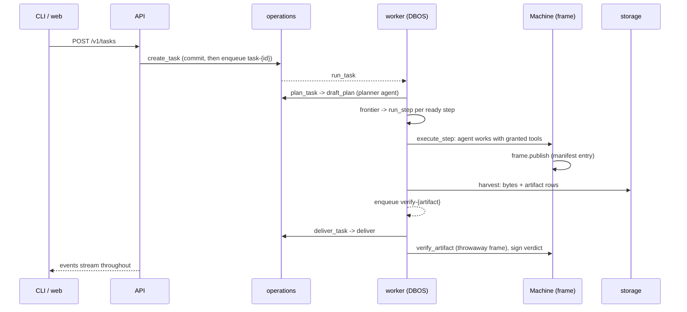

# Engine tour: one task, end to end

This page follows a single task, `prismoid do "Write a one-page memo on X"`, from the HTTP request to
the signed receipt, naming the function and file at each hop. Paths are relative to
`backend/prismoid/`. Read [architecture.md](architecture.md) first for the map, and keep
[GLOSSARY.md](GLOSSARY.md) open for the vocabulary.

A tip before you start: `prismoid tasks events <id> --follow` prints the task's durable event log as it
happens. Every hop below leaves a named event there (`task.created`, `task.dequeued`,
`task.planned`, `step.*`, `artifact.produced`, `task.delivered`, ...), so you can watch the tour
on a real task.

## 1. `create_task`: accept and commit

- **Endpoint:** `api/endpoints/tasks.py` `create_task`, routed in `api/urls.py`
  (`POST /v1/tasks`, answers 202). It authenticates the caller, validates `TaskCreateIn`
  (`api/serializers/tasks.py`), makes one call and serializes. No transaction lives in `api/`.
- **Operation:** `operations/tasks.py` `create_task`. Read its module docstring: scope-check the
  project, insert the `Task` row (`db/models/task.py`), append `task.created` to the event log,
  **commit**, and only then enqueue `run_task` through `operations/dispatch.py`
  (`get_dispatcher().enqueue("run_task", task_job_key(task.id), ...)`). The job id is
  deterministic (`task-{id}`; turn n of a follow-up is `task-{id}-t{n}`), so a second enqueue is
  a no-op. `jobs/sweeper.py` re-enqueues a committed task nobody started.

## 2. `run_task`: the workflow

- **Job:** `jobs/run_task.py` `run_task`, a DBOS workflow registered in `jobs/all.py`. Every
  `await effects.<name>(...)` inside it is a journaled effect (`jobs/effects.py`): after a crash,
  the workflow replays and finished effects return their recorded result instead of running again.
  All DBOS calls go through `jobs/durable.py`.
- In order: `mark_dequeued`; `turn_is_express` (whether the Lead decides the turn, read from its rows by `operations/turn/intake.py`);
  for turn 1, `intake_task`, which may open one gate of numbered questions and park on
  `durable.wait` at no cost; then `plan_task`, `mark_running`, and the frontier loop.

## 3. `plan_task`: draft the plan

- **Effect:** `jobs/effects.py` `plan_task` calls `operations/planning.py` `draft_plan`.
- A recipe turn's plan is code-made (`operations/plan_shapes.py`); every other turn is the Lead's one
  step (`ai/agents/lead.py`), whose plan `ai/capabilities/plan_rules.py` checks in-run and again at the
  commit, refusing cycles, unknown agents and bad dependencies, so the frontier loop can never deadlock.
  The plan becomes `Step` rows and a `task.planned` event.
- The effect returns step ids, not the plan: large payloads travel by id.

## 4. The frontier and `execute_step`

- **Frontier:** `jobs/effects.py` `frontier` returns every pending step whose dependencies are
  done. Before each wave `run_task` honours pause and cancel, applies accepted steers
  (`steer_boundary`) and asks the budget envelope (`ai/capabilities/budget_envelope.py`) whether the wave fits.
- **Step job:** `jobs/effects.py` `execute_step` is registered as the `run_step` job and enqueued
  on the step queue (`jobs/queues.py`), one child workflow per step, which is what makes
  independent steps run in parallel. It calls `operations/execution/__init__.py`
  `execute_step`.
- **Inside a step:** the step binds the task's Machine through `operations/machines`
  (`machines.acquire`; the Machine is created lazily on first use and is shared by later steps),
  builds the agent with `ai/agents/base.py` `build` (the only place a pydantic-ai `Agent` is
  constructed) and runs it with `run`. The agent's tools come from `ai/tools/frame_tools.py`
  (files, commands, publish) plus any granted families (web fetch and search, connectors, browser),
  mounted only when granted, and every call passes the `tool_record` capability
  (`ai/capabilities/tool_record.py`), which journals a `tool.called` event (a row that depends on
  how the call went is said through `ai/tools/call_rows.py`). Model calls go through `ai/gateway/` and each emits a `UsageEvent`.
- **Failure:** a failed attempt is retried by a targeted ladder (at most three attempts, each told
  what went wrong; `ai/context/retry.py` words the note), never by DBOS's blind retry. A step can park mid-run on a
  gate (`ask_user`, a connector approval, a person taking the screen) and resume on the answer.

## 5. `publish` and harvest

- **Publish:** the agent calls the `frame.publish` tool (`ai/tools/frame_tools.py`
  `_publish_or_refuse`). The driver's `publish` (`ai/frames/docker_driver.py`,
  `ai/frames/sandbar_driver.py`, `ai/frames/device_driver.py`) validates the declared type
  (`ai/frames/publish.py` `validate_publish`), then runs a fixed in-frame program with the
  arguments in a JSON file, never a shell string built from model text. It copies the bytes into
  `/artifacts`, hashes them and appends a manifest entry.
- **Harvest:** after the agent finishes, `operations/execution/__init__.py` `_harvest` reads the
  manifest and calls `operations/artifacts.py` `harvest`: bytes go to object storage
  content-addressed (`storage.py`), `Artifact` rows are inserted, `artifact.produced` is emitted.
  Collections are normalized here (`schemas/collection_repair.py`).
- The step is marked done right away, and `_enqueue_verification` enqueues one `verify_artifact`
  job per deliverable with the id `verify-{artifact_id}`.

## 6. `deliver`

- When the frontier is empty, `run_task` calls the effect `jobs/effects.py` `deliver_task`, which
  calls `operations/execution/__init__.py` `deliver`. It writes the summary for someone who was not
  watching, marks the task `delivered`, emits `task.delivered` and puts an item in the creator's
  inbox. A delivery for a superseded turn is skipped; one that finds an accepted steer nothing has
  applied yet reopens the turn and runs the frontier again.

## 7. `verify_artifact`: the receipt

- **Job:** `jobs/verify.py` `verify_artifact`, on its own `verification` queue, so it never
  competes with answers. It calls `operations/verification.py` `verify_artifact`.
- The suite for the artifact's type (`ai/verification/suites/`: `document.py`,
  `spreadsheet.py`, `deck.py`, `code.py`, ...) re-checks it, using a throwaway frame where it needs
  to run something. The report is signed with Ed25519 (`ai/verification/signing.py`; the key comes from
  `PRISMOID_SIGNING_PRIVATE_KEY`, or is generated once in dev) and stored as the artifact's verdict.
- Verification never blocks the answer or fails the task: a verdict that cannot be produced stays
  absent or signs as unverified with its reason. Fleet mode is the one lane that verifies in line
  before delivering.

## 8. What happens next

- **A follow-up** (`prismoid tasks follow-up <id> "..."`) moves the same task back to `planning` and
  enqueues `run_task` for turn n+1 with the whole thread and the earlier artifacts mounted.
- **A fork** creates a child task (`parent_task_id`) carrying the conversation and dials.
- **The Machine** goes to sleep after 10 idle minutes (`jobs/machines.py`, the `machine_sleep`
  job): its `/work` is checkpointed to storage and its sandbox destroyed, to be rebuilt on the
  next step.

## Where to go from here

- The rules each folder follows: the `CLAUDE.md` in `operations/execution/`, `jobs/`, `ai/` and
  `ai/agents/`.
- How a decision stays testable: pure functions over frozen values beside the shell that acts
  (`operations/execution/joins.py`, `operations/chat_verdict.py`).
- The decision records behind this flow: answer-first verification (ADR-019), follow-ups and
  forks (ADR-018), the Machine (ADR-063), safe-point steering (ADR-064), the durable seam
  (ADR-069). Index: [adr/README.md](adr/README.md).
