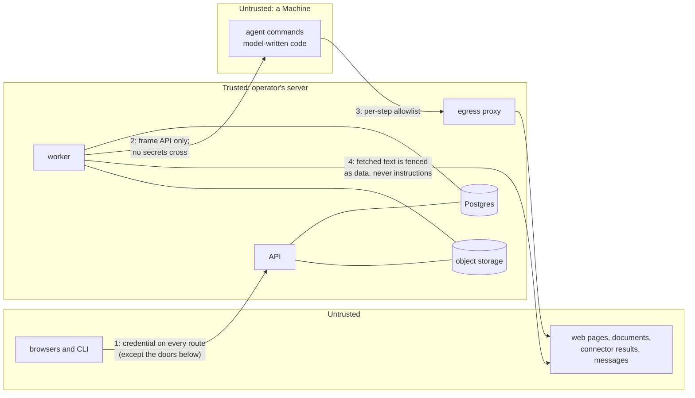

# Threat model

What Prismoid protects, from whom, where the trust boundaries are, what each sandbox guarantees and
where it stops, and what an operator must do to run Prismoid safely. To report a vulnerability, see
[SECURITY.md](../../SECURITY.md).

## What Prismoid is protecting

| Asset | Where it lives |
|---|---|
| Model provider keys, search keys, the signing key, the connector encryption key | The worker's environment and settings. Never in the database, a prompt, a Machine or a log |
| Users' passwords, sessions and API keys | Postgres, as argon2id hashes and hashed opaque tokens. Plaintext tokens are never stored or logged |
| Connector credentials (OAuth and API tokens for users' MCP servers) | Postgres, Fernet-encrypted with a rotatable key |
| Users' tasks, conversations, memories and artifacts | Postgres and object storage, scoped to a workspace and, inside it, to a project or its creator |
| The host that runs the worker and the Machines | The operator's server, or the user's own Mac in local mode |
| Money | Every model call, search query and Machine-second is metered; task and Project budgets cap spend |

## Who we defend against

1. **Content the agent reads (prompt injection).** This is the main threat. Web pages, uploaded
   documents, search results, connector tool results, bot channel messages and code in a repository
   can all carry instructions. We assume the agent can be fully steered by them and design so a
   steered agent still cannot cross a boundary: reach a host off its allowlist, run a tool it was
   not granted, read a secret, or touch another user's data.
2. **Other users of the same deployment.** Members of other workspaces, other members of a shared
   project, the author of a bot or skill someone else runs, and strangers who reach a bot through a
   channel.
3. **The network.** Anyone who can reach the API's public address without credentials.
4. **Model-written code.** Anything an agent runs inside a Machine is untrusted.

Out of scope: a malicious operator or a compromised host, and a malicious model provider.

## Trust boundaries

1. **Client to API.** Every route needs an authenticated actor except the doors listed below. The
   API authenticates, checks the workspace and project role, and hands one call to the operations
   layer.
2. **Worker to Machine.** The worker drives a Machine through the driver's API (create, exec, read
   and write files, publish, destroy). No provider key, database URL or signing key enters a
   Machine, a prompt or a fixture. Artifacts leave a Machine only through `frame.publish` and the
   harvest, and the publish hand-off passes model-written titles and paths as JSON, never through a
   shell.
3. **Machine to internet.** A Machine has no route out except the egress proxy, which allows only
   the hosts on that step's allowlist and records every refusal.
4. **Untrusted text to the model.** Text from `web.fetch`, `web.search`, the browser, connector
   results and channel messages is wrapped in fence markers that the content cannot forge (one
   guard, `schemas/egress.fence_guarded`), and agents are told to treat it as data. Fetching is
   anchored: an agent may fetch only URLs the task's own context names
   (`PRISMOID_WORKER_FETCH_CONTEXT_ANCHOR`), every redirect hop is re-checked, and private, loopback,
   link-local and metadata addresses are refused after DNS resolution and pinned for the request.
5. **Tools.** An agent may call only the tools its definition grants; the warden
   (`ai/tools/warden.py`) enforces the grant and journals every call, including refusals, with
   argument keys and never values. A connector tool that is not read-only asks the task's creator
   for approval by default, and silence is a denial.
6. **Tenancy.** Every table is classified in `db/models/tenancy.py`; every request binds its
   workspace, tenant reads fail closed, and composite foreign keys stop a reference from crossing
   workspaces. An API key acts only inside its own workspace.

## Authentication

- Passwords are hashed with argon2id. Sessions (`cs_`) and API keys (`ck_`) are opaque random
  tokens stored as hashes; there are no JWTs, so revocation is immediate.
- A live stream (SSE or WebSocket) re-proves its credential and task access every
  `PRISMOID_API_STREAM_REAUTH_SECONDS` (default 10) and closes on the first failure.
- Completing a password reset revokes every live session and API key of that user.
- Signup is controlled by `PRISMOID_AUTH_SIGNUP_ENABLED`. The production compose file defaults it to
  `false`, which makes signup invite-only. No web path grants platform admin: the first admin is
  made on the server with `prismoid admin bootstrap`, or by `prismoid up`'s first run in local mode.

### Doors that do not take a session or API key

Each of these authenticates some other way, and each is a place to look first in a review.

| Door | What authenticates it |
|---|---|
| `GET /healthz` | Nothing; status only. `/healthz/full` needs an actor |
| `POST /v1/auth/signup`, `POST /v1/auth/login` | The credentials themselves; rate-limited per address and IP. Signup needs a live invite for that address when signup is off |
| `POST /v1/auth/forgot-password`, `POST /v1/auth/reset-password` | An emailed, single-use, hashed `cr_` code with a short TTL (15 minutes by default), superseded by a new request. Mail is sent off the request path |
| `GET /v1/connectors/oauth/callback` | A single-use, hashed `cn_` state token, bound to the browser that started the sign-in by a cookie |
| `POST /v1/routines/{id}/fire` | The routine's own long-lived hashed `rt_` token (or an actor). It can only start runs of that routine; burst-capped; its payload is treated as data |
| `GET /v1/templates/bots/{slug}` | Nothing: serves a published bot template only |
| `POST` and `GET /v1/channels/{id}/messages` | The channel's hashed `bc_` token. It accepts a line and reads a feed, nothing else; every line passes the allowlist, caps and fence |
| `POST /v1/channels/inbound/email` | An operator-set shared header secret. The email channel kind is currently refused at creation and at this door, because inbound mail carries no sender-authentication verdict yet |
| `WS /v1/tasks/{id}/screen` | A single-use, 30-second, Ed25519-signed `st_` ticket minted by an authenticated `POST /v1/tasks/{id}/screen/ticket`, bound to the credential and the connection; re-checked every reauth interval. Ticket values are redacted from access logs |
| sandbar's `GET /v1/sandboxes/{id}/display` (on the sandbar daemon) | A single-use, 30-second `dt_` ticket signed by the API; sandbar holds only the public keys (`SANDBAR_DISPLAY_KEYS`) |
| `GET /v1/blobs/{digest}` (local mode only) | A short-lived HMAC-SHA256 signature over the request, keyed by a 0600 file in the data home. It answers 404 unless `PRISMOID_ENV=local` with file storage, which staging and production refuse at boot |
| The web app catch-all (local mode only) | Serves the built web app's files only, and only when `PRISMOID_LOCAL_WEB_DIR` is set |

## Sandbox guarantees and limits

The driver is chosen with `PRISMOID_WORKER_FRAME_DRIVER`. Pick it for the users you serve.

### `docker` (the default)

Each Machine is a container on the local Docker daemon.

Guarantees:
- No default route out: the container sits on an internal Docker network (`prismoid_frame_net`), and
  the only way to the internet is the egress proxy with the step's allowlist. The proxy's control
  port is guarded by `PRISMOID_EGRESS_CONTROL_SECRET`, so a frame cannot widen its own allowlist when
  the secret is set.
- All Linux capabilities dropped, `no-new-privileges`, memory and process-count limits; agent
  commands run as a non-root user.

Limits:
- **Containers share the host kernel.** A kernel exploit from model-written code is a host
  compromise. Use this driver only for yourself or users you trust.
- The worker needs the Docker socket, which is root-equivalent on the host.
- An internal Docker network still gives the host an address on it, so a dev frame can reach
  services the host publishes on all interfaces. The dev compose file publishes Postgres (5433),
  MinIO (9000, 9001) and the proxy's control port (3129) that way, with development passwords.
  Never use the dev stack with untrusted users.

### `sandbar`

The [sandbar](../../sandbar/README.md) daemon owns the Docker socket and creates each sandbox; the
worker never touches Docker. This is what the single-host deploy runs.

Guarantees:
- The worker talks to sandbar over HTTP with a bearer token (`SANDBAR_TOKEN`); run the daemon on a
  private network.
- A sandbox with no allowed domains has no network. One with domains gets its own small network
  whose only member besides it is the relay to sandbar's egress proxy, so sandboxes cannot reach
  each other; IPv6 is disabled inside. Every refusal is recorded.
- All capabilities dropped, `no-new-privileges`, memory and CPU limits.

Limits:
- With the Docker backend, sandboxes still share the host kernel. Treat it as the `docker` driver's
  isolation with better network separation. gVisor (`SANDBAR_DOCKER_RUNTIME=runsc`, a user-space
  kernel per sandbox) is optional hardening that is documented and **unproven** here. The
  Firecracker backend, which gives each sandbox its own kernel, is **experimental** and not
  supported for production.
- The file door: an agent's file read or write runs inside the sandbox as the agent's uid (1000),
  so a link the workload planted carries it nowhere the workload could not already reach. A system
  write (the Engine's, as root: Prismoid's task, skill and artifact paths) refuses a parent that has a
  symbolic link in it, at the time of the check. That is a point-in-time check: a parent the
  workload can rename may still move under the write. Prismoid confines `read_file` to the agent's
  own roots (`/work`, `/artifacts`, `/task`, `/skills`; a device's grants and `/out`) before the
  driver is called, and folds the model's path (`.`, `//`, `..`) first; sandbar enforces the uid,
  and a refusal from its door (a `400` or a `403` `forbidden_path`) reaches the model as a policy
  refusal, never a failed step.
- The Docker backend sets no process-count limit, storage cap or read-only root filesystem today.

### `device` (local mode, macOS)

`prismoid up` makes the user's own Mac the Machine. The threat is a prompt-injected agent, not a
compromised Prismoid: the worker, API and helper are one person's processes.

Guarantees:
- One process touches the computer: the device helper, on a Unix socket in the data home, requiring
  a key file (0600) on every route. It imports only settings, schemas and the egress relay, builds
  each command's environment from an allowlist, and judges every path, grant and Docker call
  itself.
- Every agent command runs under a generated Seatbelt (`sandbox-exec`) profile that starts from
  deny-all: reads everywhere except a deny list of secret locations and Prismoid's own data, writes only
  in the folders granted to the task and a per-task cache, network only through the egress proxy
  and loopback (minus Prismoid's own ports). Files that run code later (`.git/hooks`, `.envrc`, shell
  rc files) stay write-protected inside a granted folder.
- The embedded Postgres listens on a Unix socket only (no TCP port), with password authentication.
  The API binds `127.0.0.1`.
- A device task never joins a project with other members, and only its owner drives it. A step the
  worker or helper lost is never re-run on its own; it waits for the person.

Limits (see the decision record for the full list,
[ADR-078](../adr/078-the-device-machine.md), "Known limits"):
- **Loopback is wide open.** A local proxy the person runs, or a Chrome started with
  `--remote-debugging-port`, is reachable from inside the fence and is an egress bypass.
- A server bound to `0.0.0.0` is reachable from the local network for up to about 2 seconds before
  the listener watch kills it; UDP listeners are not watched. A daemon that detaches to launchd
  cannot be proven to be the task's and is not killed.
- Everything runs as the same macOS user. Files a person later runs by hand (`Makefile`,
  `package.json` scripts, editor launch configs) are ordinary project files the agent may write in
  a read-write folder; review the diff.
- Container egress through the helper's Docker proxy is not fenced.
- During a sign-in hand-off in the Prismoid Chrome window, a listed site's own scripts and an open
  redirect on a listed host can carry data off the list.

## Operator hardening checklist

For any deployment other than one person on their own computer:

- [ ] Run with `PRISMOID_ENV=prod` (or `staging`). This turns on boot refusals: console email, file
      storage and a missing screen signing key stop the boot.
- [ ] Use the single-host stack in `deploy/` or an equivalent: only the TLS proxy (Caddy) is
      published to the internet; Postgres, MinIO, sandbar and the egress proxy stay on private
      networks or loopback. Follow `docs/runbooks/ingress.md` and `deploy/PROVISION.md`.
- [ ] Use the `sandbar` driver, never `docker`, if users other than you run tasks. Only sandbar
      gets the Docker socket.
- [ ] Keep `PRISMOID_AUTH_SIGNUP_ENABLED=false` and invite users; create the first admin with
      `prismoid admin bootstrap` on the server.
- [ ] Set `PRISMOID_EMAIL_BACKEND=smtp` with real SMTP credentials.
- [ ] Generate and set every secret instead of relying on development defaults:
      `PRISMOID_SIGNING_PRIVATE_KEY`, `PRISMOID_CONNECTORS_ENCRYPTION_KEY`, `SANDBAR_TOKEN`,
      `PRISMOID_API_SCREEN_SIGNING_KEY` (when computer use is on), `PRISMOID_EGRESS_CONTROL_SECRET` (if
      you run the `docker` driver's egress proxy), and the Postgres and MinIO passwords (the dev
      stack uses `prismoid` and `prismoid1234`). `deploy/.env.example` names each with the command that
      generates it; there the names drop the `PRISMOID_` prefix (`SIGNING_PRIVATE_KEY`).
- [ ] Set `PRISMOID_API_FORWARDED_ALLOW_IPS` to your proxy's address so rate limits see real client
      IPs.
- [ ] Keep `PRISMOID_WORKER_FETCH_CONTEXT_ANCHOR=true`, `PRISMOID_WORKER_FETCH_ALLOW_INSECURE_LOCALHOST=false`
      and `PRISMOID_CONNECTORS_ALLOW_INSECURE_LOCALHOST=false` (the defaults).
- [ ] Enable only the bot channel kinds you need (`PRISMOID_CHANNELS_KINDS`), or turn channels off
      with `PRISMOID_CHANNELS_ENABLED=false`.
- [ ] Set task and Project budgets that bound what a misused account can spend, and verify the
      prices in your model catalog.
- [ ] Set `PRISMOID_WORKER_APP_VERSION` to the release's git sha on every deploy, so a new worker
      cancels the previous version's leftover work instead of adopting it.
- [ ] Back up Postgres and object storage (`deploy/backup/`), and test a restore
      (`just backup-restore`).
- [ ] Track `main` for security fixes (see [SECURITY.md](../../SECURITY.md)).
